<!-- ═══════════════════════════ HEADER ═══════════════════════════ -->

  

  

  
  
  

  
  

 

<!-- ═══════════════════════════ ABOUT ═══════════════════════════ -->
## 👋 About me

I'm Yerosen, a software developer. I take an idea from an empty repo to something live: the interface people see, the logic behind it, sign-in, data, and deployment.

Lately that has meant a media app with email and Google sign-in, an AI agent that reads Telegram chats and sends back summaries, an Android app that turns screen time into a daily verdict, and a niche tool for Ethiopian kirar music. The projects look different, but the habits are the same: ship something working early, keep the scope clear, and leave behind code that someone else can run.

If you have a product to launch, a repetitive process to automate, or an idea that needs a first working version, I'd like to hear about it.

 

<!-- ═══════════════════════════ SERVICES ═══════════════════════════ -->
## 🧰 What I can build for you

| | What you get | Built with | See it in |
|---|---|---|---|
| **🌐 Websites & web apps** | Landing pages, dashboards and member areas with login, designed to look finished and to work on a phone | React, Next.js, Tailwind, Supabase, Vercel | [Laura](https://github.com/yerosentamrat63/Laura---Free-Movie-Streaming-site), [Portfolio](https://github.com/yerosentamrat63/Yerosen_Tamrat_portfolio) |
| **📱 Mobile apps** | Android apps with native features like usage data, home-screen widgets and reminders | Flutter, Dart, Kotlin | [Hindsight](https://github.com/yerosentamrat63/hindsight) |
| **🤖 AI & automation** | Agents and bots that read, summarize and act on your messages or data, so nobody does it by hand | Python, Groq and other LLM APIs, Telegram (Telethon), Render | [Telegram Agent](https://github.com/yerosentamrat63/telegram-agent), [Hindsight](https://github.com/yerosentamrat63/hindsight) |
| **🛠️ Custom tools** | Focused tools built around a specific domain or workflow | Web or Java, depending on the job | [Kirar Melody Finder](https://github.com/yerosentamrat63/kirar-melody-finder), [City Racer](https://github.com/yerosentamrat63/city-racer) |

 

<!-- ═══════════════════════════ WORK ═══════════════════════════ -->
## 🚀 Selected work

<table>
<tr>
<td width="50%" valign="top">

### 🎬 [Laura](https://github.com/yerosentamrat63/Laura---Free-Movie-Streaming-site)
**A media browsing app with a clean, responsive interface.** Browse by genre, search instantly (Ctrl/Cmd + K), keep a watchlist, and sign in with email or Google.

*What it shows:* front-end polish, real authentication, and a live deployment.

🔗 [**Live demo**](https://laura-drab.vercel.app) · [Code](https://github.com/yerosentamrat63/Laura---Free-Movie-Streaming-site)

</td>
<td width="50%" valign="top">

### 🤖 [Telegram Agent](https://github.com/yerosentamrat63/telegram-agent)
**Too many chats to read?** Ask the agent in plain English, or with `/summarize`, for a summary of any chat or channel: the last N messages, or only what's unread.

*What it shows:* LLM integration, bot development, and a cloud deployment with a documented setup.

🔗 [Code](https://github.com/yerosentamrat63/telegram-agent)

</td>
</tr>
<tr>
<td width="50%" valign="top">

### 📱 [Hindsight](https://github.com/yerosentamrat63/hindsight)
**Screen time, judged.** An Android app that sorts your phone use into wasted, neutral and productive against your own goal, then turns it into a daily verdict and a shareable weekly receipt. The app does the math; an AI model only writes the wording.

*What it shows:* native Android features (usage data, home-screen widgets, reminders) and AI integration that supports several providers, with an optional server-side proxy so API keys never ship inside the app.

🔗 [Code](https://github.com/yerosentamrat63/hindsight)

</td>
<td width="50%" valign="top">

### 🎶 [Kirar Melody Finder](https://github.com/yerosentamrat63/kirar-melody-finder)
**A ቅኝት (mode) finder for the Ethiopian kirar.** Work out which ቅኝት a melody uses after you hear it.

*What it shows:* building a specialised tool around a real domain, shipped live and still improving.

🔗 [**Live demo**](https://kirar-melody-finder.vercel.app) · [Code](https://github.com/yerosentamrat63/kirar-melody-finder)

</td>
</tr>
</table>

Also built: <a href="https://github.com/yerosentamrat63/city-racer"><b>City Racer</b></a>, a 3D passenger-delivery game in Java and LWJGL 3.

 

<!-- ═══════════════════════════ HOW I WORK ═══════════════════════════ -->
## 🤝 How I work

- **Scope first.** We agree on what "done" looks like before I write code.
- **Live early.** I deploy from the start, so you can click through a real version instead of reading status updates.
- **Clean handoff.** Every project gets a README, an example env file and setup steps, so anyone can run it after me.
- **Plain updates.** No jargon, and I tell you early if something will take longer.

 

<!-- ═══════════════════════════ TECH ═══════════════════════════ -->
## 🛠️ Tech

  

  <b>Languages</b> Python · Java · JavaScript · TypeScript · Dart · Kotlin · C++ &nbsp;|&nbsp; <b>Web</b> React · Next.js · Vite · Tailwind &nbsp;|&nbsp; <b>Mobile</b> Flutter &nbsp;|&nbsp; <b>Services</b> Supabase · Cloudflare Workers · Groq · Telethon · TMDB &nbsp;|&nbsp; <b>Graphics</b> LWJGL 3 · OpenGL

 

<!-- ═══════════════════════════ BACKGROUND ═══════════════════════════ -->
## 🎓 Background

BSc Computer Science student at American College of Technology (2024 – 2028), with coursework in databases, OOP with Java, networking and computer architecture. I trained in the A2SV software engineering program in 2026 and practice algorithms regularly.

<b>Problem solving and GitHub activity</b>

 

  

  Every solution lives in <a href="https://github.com/yerosentamrat63/DSA"><b>yerosentamrat63/DSA</b></a>.

  
  

<picture>
  <source media="(prefers-color-scheme: dark)" srcset="https://raw.githubusercontent.com/yerosentamrat63/yerosentamrat63/output/github-contribution-grid-snake-dark.svg">
  <source media="(prefers-color-scheme: light)" srcset="https://raw.githubusercontent.com/yerosentamrat63/yerosentamrat63/output/github-contribution-grid-snake.svg">
  
</picture>

 

<!-- ═══════════════════════════ CONTACT ═══════════════════════════ -->
## 📫 Let's talk about your project

Send me a short email with **what you want built, a rough deadline, and a budget range**. I'll reply with questions or a plan.

  
  

Also open to software engineering internships.

  

